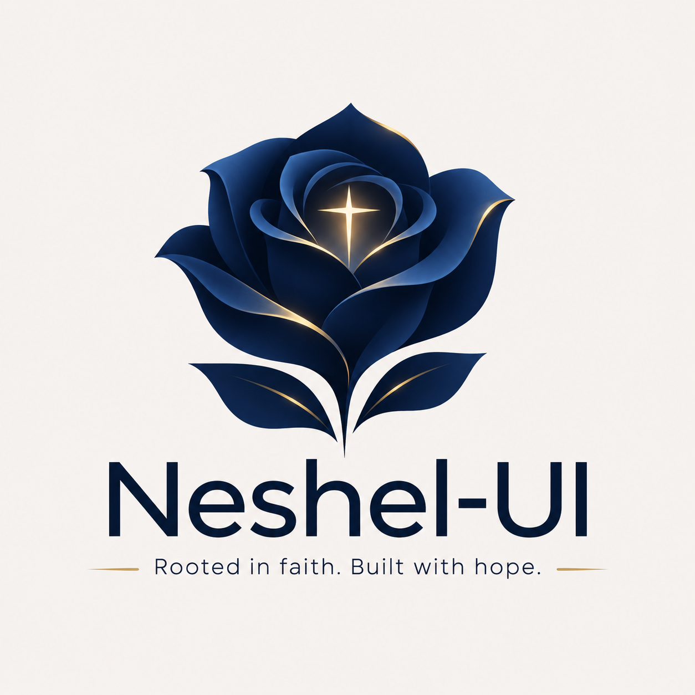

<p align="center">
  
</p>

<h1 align="center">Neshel-UI</h1>

<p align="center">
  <strong>Rooted in faith. Built with hope.</strong><br />
  A modular, accessible and themeable React design system.
</p>

<p align="center">
  <a href="#packages">Packages</a> ·
  <a href="#quick-start">Quick start</a> ·
  <a href="#documentation">Documentation</a> ·
  <a href="#development">Development</a> ·
  <a href="#project-status">Status</a> ·
  <a href="#contributing">Contributing</a>
</p>

> [!IMPORTANT]
> **Release candidate 0.1.0 — not published to npm yet.** All five packages are implemented and
> verified from packed tarballs in external Vite and Next.js applications on Linux, Windows and
> macOS. Until the owner authorises the first publication, install them from local tarballs (see
> [Quick start](#quick-start)).

Neshel-UI gives React applications **semantic design tokens**, **layout primitives**,
**metrics-aware typography**, **accessible components** and a **build-time CLI** — as independent
packages you install only when you need them. It is CSS-first (Tailwind CSS v4 optional, plain CSS
supported), needs no runtime provider for theming, and works in React Server Components.

The navy, ivory and gold appearance is Neshel's default; your application owns its identity through
`neshel.config.ts`.

## Packages

| Package                                        | What it gives you                                                                     |
| ---------------------------------------------- | ------------------------------------------------------------------------------------- |
| [`@neshel-ui/config`](packages/config)         | Tokens as CSS custom properties; light, dark, system and named themes; `defineConfig` |
| [`@neshel-ui/layout`](packages/layout)         | `Box`, `Flex`, `Stack`, `Inline`, `Grid`, `Center`, `Container`                       |
| [`@neshel-ui/typography`](packages/typography) | `Heading`, `Text`, `Paragraph`, `Caption` with Capsize trimming                       |
| [`@neshel-ui/components`](packages/components) | Buttons, cards, form controls, overlays, selection, navigation, application shell     |
| [`@neshel-ui/cli`](packages/cli)               | `neshel validate` and `neshel generate` for themes, fonts and custom breakpoints      |

Peer dependencies: `react` and `react-dom` 19. ESM only, TypeScript declarations included.

## Quick start

After the 0.1.0 publication:

```bash
pnpm add @neshel-ui/config @neshel-ui/layout @neshel-ui/typography @neshel-ui/components
```

Today, from a clone of this repository:

```bash
pnpm install --frozen-lockfile
pnpm build:packages
node scripts/pack-local.mjs --out ../neshel-tarballs
# in your application:
node <path-to-neshel-ui>/scripts/pack-local.mjs --use ../neshel-tarballs && pnpm install
```

```css
/* your global CSS — with Tailwind v4 (or import @neshel-ui/config/tokens.css without it) */
@import "tailwindcss";
@import "@neshel-ui/config/tailwind.css";
@import "@neshel-ui/layout/styles.css";
@import "@neshel-ui/typography/styles.css";
@import "@neshel-ui/components/styles.css";
```

```tsx
import { Button } from "@neshel-ui/components";
import { Stack } from "@neshel-ui/layout";
import { Heading, Paragraph } from "@neshel-ui/typography";

export function Welcome() {
  return (
    <Stack space="4" alignX="start">
      <Heading as="h1">Welcome</Heading>
      <Paragraph tone="muted">Rooted in faith. Built with hope.</Paragraph>
      <Button>Get started</Button>
    </Stack>
  );
}
```

Ready-made projects: [`starters/`](starters) (Vite + Tailwind, Vite + plain CSS, Next.js App Router).

## Documentation

The official documentation website (English and Spanish) lives in [`apps/docs`](apps/docs): getting
started tutorials, guides, the complete component catalogue with live previews and API tables
generated from the TypeScript declarations, the CLI reference and application examples.

```bash
pnpm docs:dev       # http://localhost:3000
pnpm docs:build     # static export to apps/docs/out
pnpm docs:preview   # serve the export
```

Its public deployment awaits the owner (see [docs/releasing.md](docs/releasing.md)). Maintainer
and contract documentation stays in [`docs/`](docs) and [`specs/`](specs).

## Development

Contributors are equally supported on **Windows, Linux and macOS**; every command runs unchanged in
PowerShell 7, Bash and Zsh. Requirements: **Node.js 26** (22.13+ supported), **pnpm 12.16.1**
(pinned by `packageManager`), Git.

```bash
git clone https://github.com/dannysequeira-dev/neshel-ui.git
cd neshel-ui
pnpm install --frozen-lockfile
pnpm check
```

| Command                                           | What it verifies                                                                                 |
| ------------------------------------------------- | ------------------------------------------------------------------------------------------------ |
| `pnpm check`                                      | doctor, lint, typecheck, tests, package build, exports, packed artefacts                         |
| `pnpm check:consumer`                             | packed tarballs in external React 19 + Vite apps (Tailwind, plain CSS, themes, breakpoints, SSR) |
| `pnpm check:browser` / `check:browser:components` | computed styles; real keyboard/pointer interaction and axe in Chrome                             |
| `pnpm check:browsers`                             | Chromium, Firefox and WebKit smoke flows (Playwright)                                            |
| `pnpm check:next`                                 | isolated Next.js App Router app from packed packages (SSR, hydration, portals)                   |
| `pnpm check:starters` · `check:bundles`           | starters from deterministic ZIPs · per-family bundle budgets                                     |
| `pnpm check:docs` · `check:docs-site`             | documentation coverage, translations, links, snippets · exported site smoke with axe             |
| `pnpm release:simulate`                           | the 0.1.0 versioning transition and `npm publish --dry-run`, in a temporary copy                 |

Working agreements: [constitution](.specify/memory/constitution.md), [architecture](docs/architecture.md),
[package contracts](docs/package-contracts.md), [decisions](docs/decisions/README.md),
[cross-platform policy (Spanish)](docs/CROSS-PLATFORM.es.md), [contributing](CONTRIBUTING.md).

## Project status

| Phase   | Focus                                                                | Status      |
| ------- | -------------------------------------------------------------------- | ----------- |
| 001–005 | Foundation, tokens and CLI, layout, typography, components and shell | Done        |
| 006     | Documentation website, developer experience, release candidate       | In progress |
| 007     | First npm publication (owner-authorised)                             | Planned     |

Release readiness and its evidence: [docs/release-readiness.md](docs/release-readiness.md). The
`@neshel-ui` npm organisation has not yet been confirmed.

## Brand identity

The emblem is a **navy-blue rose** with restrained golden reflections and a quiet light at its
heart, representing faith as the foundation and hope as the reason to keep building. The original
artwork is preserved unchanged in [`assets/brand/`](assets/brand) — see the
[brand asset guide](docs/BRANDING.md) and the [brand usage policy (draft)](docs/BRAND-POLICY.md).

## Contributing

Thoughtful contributions are welcome: read the [contribution guide](CONTRIBUTING.md),
[code of conduct](CODE_OF_CONDUCT.md) and [security policy](SECURITY.md).

## License

The software is released under the [MIT license](LICENSE). The MIT license does not grant rights to
the Neshel-UI name or logo; see the [brand usage policy (draft)](docs/BRAND-POLICY.md).

---

<p align="center"><em>“May the God of hope fill you with all joy and peace as you trust in him.” — Romans 15:13</em></p>
